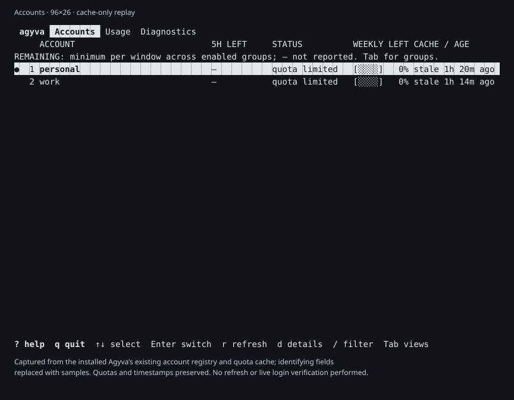

# agyva

[](https://github.com/0x1d1e/agyva/actions/workflows/ci.yml)
[](LICENSE)
[](#install)
[](https://github.com/0x1d1e/agyva/releases)

A manual account manager for Google's Antigravity CLI (`agy`). `agy` keeps one
login at a time; agyva saves the logins you already have as encrypted snapshots
and puts the one you pick back where `agy` expects it. It also shows quota and
health, offers a terminal UI, and never switches accounts on its own. Rust, one
binary, no daemon, Linux only for now.

> **Unofficial.** Agyva is not affiliated with or endorsed by Google. See
> [Policy](#policy-read-this-first) before saving more than one account.

## Why not just log out and in?

Because `agy` holds one login at a time, so every change of account is a
browser round-trip that also leaves the previous login nowhere. Agyva keeps
the logins you already have, puts the one you pick back where `agy` expects
it, and treats that move as a verified local transaction with an encrypted
copy of what was there before.

## Screenshot



**SYNTHETIC**: fake accounts (`example.invalid`), a fake `agy` script and
made-up quota numbers, captured from a throwaway sandbox by
`scripts/capture-tui.sh`. This is not a recording of any real account. More
frames: [`docs/tui-capture.txt`](docs/tui-capture.txt).

## Quick start

```sh
agyva add --alias personal   # while agy is logged in as that account
agyva add --alias work       # after logging in to the second account with agy
agyva use personal
agyva usage
```

`agyva add` saves whatever login `agy` currently holds. Log in with `agy` first,
once per account, then save it. Switching is manual, and a running `agy` keeps
the login it started with: restart `agy` after `agyva use`.

## Install

Requirements: Linux, a Rust toolchain (stable, 1.88 or newer; `rustup` reads
`rust-toolchain.toml`), and a Secret Service provider (GNOME Keyring,
KeePassXC, KWallet with the Secret Service bridge) for the default key storage.

### From source

```sh
git clone https://github.com/0x1d1e/agyva.git
cd agyva
cargo install --path . --locked     # installs to ~/.cargo/bin/agyva
```

### Release tarball

A tagged release publishes a Linux archive and `SHA256SUMS` on the
[releases page](https://github.com/0x1d1e/agyva/releases); none has been
tagged yet. Verify before installing:

```sh
sha256sum -c SHA256SUMS
tar -xzf agyva-0.1.0-x86_64-unknown-linux-gnu.tar.gz
install -Dm755 agyva-0.1.0-x86_64-unknown-linux-gnu/agyva ~/.local/bin/agyva
```

You can also build the same archive locally with `scripts/release.sh`. The
archive is normalised (sorted entries, fixed owner and mtime, no gzip
timestamp), but bit-identical output across different machines or compilers is
not promised. Agyva does not edit your shell configuration.

### Shell completions

```sh
# Fish (also completes saved aliases for use / rename / remove / usage / health)
agyva completions fish > ~/.config/fish/completions/agyva.fish

# Bash
agyva completions bash > ~/.local/share/bash-completion/completions/agyva

# Zsh (put a directory on $fpath yourself)
agyva completions zsh > ~/.zfunc/_agyva
```

The Fish alias completion runs `agyva list --json`, which reads only the public
registry (no keyring access, no secrets).

## Safety at a glance

- **Encrypted snapshots.** Every saved login and pre-switch checkpoint is an
  AES-256-GCM envelope with a random nonce and authenticated metadata. The
  vault key lives in the OS keyring, or is derived with Argon2id from a
  passphrase when no keyring is available.
- **Journaled switches.** The current login is checkpointed first; the result is
  read back and verified; an interrupted switch is finished or rolled back by
  `agyva recover`.
- **No automatic rotation.** Agyva never switches because of a quota error and
  never retries an account marked suspended.
- **The `agy` binary is untouched.** Agyva moves `agy`'s own stored login as
  opaque bytes and never writes to, patches or wraps the executable.
- **No network of its own.** Quota comes only from running `agy -p "/usage"`;
  agyva makes no HTTP requests and sends no telemetry.
- **No secrets in output.** Errors and `--json` never carry credential
  material, and secrets live in zeroizing wrappers with redacted `Debug`.

Full detail: [`docs/security.md`](docs/security.md).

## Commands at a glance

| Command | Purpose |
| --- | --- |
| `agyva` | Terminal UI on a terminal, help otherwise. |
| `add [--alias A] [--refresh]` | Save the account `agy` is logged in as. `--refresh` updates an already saved account. |
| `list [--json]` | Saved accounts. |
| `use <selector> [--force]` | Switch `agy` to a saved account. `--force` replaces an `agy` login agyva has not saved (an encrypted copy is kept). |
| `current [--json]` | Which account `agy` is logged in as. |
| `rename <selector> <new>` | Change an alias. |
| `remove <selector> [-y] [--force]` | Forget a saved account. `agy`'s own login is never touched. |
| `usage [selector] [--all] [--json] [--no-refresh] [--force-refresh]` | Quota. |
| `health [selector] [--json] [--no-refresh] [--force-refresh]` | Per-account health. |
| `watch` | Foreground monitor; read-only; stops on Ctrl+C. |
| `status [--json]` | Agyva's state and any pending recovery. |
| `doctor [--json]` | Read-only diagnosis. |
| `recover [--rollback] [--force]` | Finish or undo an interrupted switch. |
| `config show \| set <key> <value> \| path` | Settings. |
| `completions fish\|bash\|zsh` | Completion script. |
| `version` | agyva and detected `agy` versions. |

A **selector** is an alias, a list number, an exact email, an account id (or
unique prefix), or `-` for the previous account. Global flag:
`--allow-untested` (see [compatibility](#agy-compatibility)).

```console
$ agyva list
#   ALIAS  EMAIL                  ID          LAST USED
*1  alice  alice@example.invalid  c043558106  2026-11-15 08:33
 2  bob    bob@example.invalid    61602d69cb  never
 3  carol  carol@example.invalid  75350e5035  never

$ agyva use bob
Switched to bob <bob@example.invalid> [61602d69cb]
note: Restart agy to use the new account; agy sessions that are already running keep their old login.

$ agyva use nobody
error: no saved account matches `nobody`
hint: see `agyva list` for aliases, numbers and ids
```

(Captured from the synthetic sandbox in `scripts/demo-sandbox.sh`; fake
accounts, no real data.)

### Exit codes

| Code | Meaning |
| --- | --- |
| 0 | Success |
| 1 | Error. The message is on stderr, followed by a `hint:` line. `doctor` also exits 1 when it finds a problem. |
| 2 | Usage error: bad arguments, selector or setting. |
| 3 | Recovery required: an interrupted switch is pending, or a keyring write timed out and its outcome is unknown. Run `agyva recover`. |

Exit code 99 exists only for the test-mode crash simulation.

## Configuration

`agyva config show` lists every setting with its meaning; `agyva config path`
prints the file. Keys: `backend`, `vault_key`, `color`, `allow_untested_agy`,
`checkpoints_keep`, `lock_timeout_secs`, `policy_acknowledged`,
`quota_fresh_secs`, `quota_min_refresh_secs`, `watch_interval_secs`,
`desktop_notifications`.

`backend` chooses how agyva reads agy's live credential: `auto`,
`secret-service` or `file`. The test-only `memory` backend is available only
through `AGYVA_BACKEND=memory` with every sandbox directory redirected.

## Terminal UI

Bare `agyva` on a terminal opens an interactive view: accounts with 5-hour and
weekly quota bars, health, a details window, a usage view and diagnostics.
Enter switches (after a confirmation that reminds you to restart `agy`), `r`
refreshes the active account, `d` opens details, `Tab` changes views, `/`
filters, `?` lists every key. See the [screenshot](#screenshot) above.

## Credential security model

What agyva does:

- Each saved login and each pre-switch checkpoint is an **AES-256-GCM**
  envelope: versioned header, random 96-bit nonce, and authenticated data that
  binds the format, algorithm and the file's role. A file copied into another
  account's slot, a flipped bit or a changed version fails to open.
- The 256-bit **vault key** is stored in the OS keyring (service `agyva`). If no
  keyring is reachable, or `vault_key = passphrase`, the key is derived with
  **Argon2id** (19 MiB, t=2, p=1 by default; stored parameters are bounds
  checked) from a passphrase of at least 8 characters, read from a terminal
  prompt or `AGYVA_PASSPHRASE`, never from argv.
- No plaintext key file, no plaintext credential copies, no `.bak` files.
  Files are 0600, directories 0700, writes are atomic (temp file, fsync,
  rename).
- Secrets live in zeroizing wrappers with redacted `Debug`; errors and
  `--json` never carry credential material.
- The `agy` login itself is moved verbatim, as opaque bytes.

What it does **not** do, stated plainly:

- **Encryption does not protect against a compromised session.** Anything
  running as you, while your keyring is unlocked, can read the vault key and
  also `agy`'s own live login directly. Agyva adds no protection against that;
  it protects the *saved* copies at rest (for example in a backup or a lost
  disk) from someone without your keyring or passphrase.
- Checkpoints keep older logins (encrypted). A login you revoked at Google can
  linger in a checkpoint until it is pruned; pinned checkpoints (created by
  `--force` and `recover --force`) are never pruned automatically.
- An old copy of an encrypted file can be put back by an attacker who can
  write to your config directory (rollback of an old blob). Agyva does not
  detect this; it is a known, documented limitation.
- `AGYVA_PASSPHRASE` is moved into a zeroizing holder at startup, but cannot be
  removed from the process environment (doing so needs `unsafe` code, which
  this project avoids); child processes it launches never receive it. Prefer
  the interactive prompt where you can.
- There is a short, inherent window between agyva's last check of `agy`'s login
  and its write, in which another process could still change it.

Full detail: [`docs/security.md`](docs/security.md).

## agy compatibility

| Area | Status |
| --- | --- |
| `agy` version gate: 1.5.x supported; others refused unless `--allow-untested` | Enforced by agyva. The `agy X.Y.Z` output format was observed locally on `agy 1.5.9` (one observation; see `docs/compatibility.md`). |
| `agy -p "/usage" --output-format json` schema (groups, buckets, `remaining_fraction`, `reset_time`) | **Observed on agy 1.5.9**; undocumented, parsed defensively, anything else is "schema changed". |
| Credential document shape (consumer login) | **OBSERVED-LOCALLY on `agy 1.5.9`**: `token` (`access_token`, `token_type`, `refresh_token`, `expiry`, `expires_in`), `auth_method`, `id_token_email`; `id_token` is optional and omitted on consumer logins. One live sample; GCP/enterprise shapes are unverified. |
| Companion files (`installation_id`, `settings.json` `gcp` block), token-file path | **FROM-REFERENCE**: taken from public descriptions, exercised only with synthetic data. |
| Writing the Secret Service item (`gemini` / `antigravity`) byte-compatibly with what real `agy` expects: attributes, label, content type | **UNVERIFIED** against a real `agy`. Agyva writes `application/octet-stream`; the Go keyring library agy is believed to use writes `text/plain`. |
| The opt-in real-keyring test (`tests/real_keyring.rs`) | **NOT RUN** in this release. |
| macOS Keychain and Windows Credential Manager | Not supported; code and CI jobs are disabled. |

Details and the checks you can run yourself: [`docs/compatibility.md`](docs/compatibility.md).

**Linux only (for now).** The default backend is the freedesktop Secret
Service over D-Bus. The alternative `backend = file` handles `agy` setups that
keep the token in `~/.gemini/antigravity-cli/antigravity-oauth-token`.

**Restart `agy` after every switch.** A running session keeps the login it
started with. Agyva reports detected sessions (from `presence/*.lock` files
and the process list) but never signals or kills them.

### Headless and no-D-Bus systems

With no Secret Service reachable, agyva's own vault falls back to a passphrase
(`vault_key = passphrase`, or automatically when no keyring answers). `agy`
itself then needs a store agyva can reach: set `backend = file` if your `agy`
keeps its token in the file. If `agy` keeps its login only in a keyring you
cannot reach, agyva cannot read or write it, and `agyva doctor` says so.

## Quota and health

- Quota has **one source**: `agy -p "/usage" --output-format json`, which
  answers for the account `agy` is **currently logged in as**. Agyva makes no
  network requests of its own.
- Therefore only the **active** account is refreshed. Other accounts show their
  last cached reading, labelled `cache` or `stale` with its age, or "not
  checked yet". To refresh another account, switch to it.
- The output schema is undocumented and may change. Unknown shapes are
  reported as unavailable; agyva never guesses a number.
- Minimum refresh interval 60 s (`quota_min_refresh_secs`); fresh for 300 s
  (`quota_fresh_secs`). A throttled or failed refresh keeps the previous cache
  entry and records the failure.
- **Health semantics.** `terms-suspended` is reported only when `agy` prints an
  explicit Terms of Service violation message. A bare HTTP 403 or
  `PERMISSION_DENIED` is `unknown`, because it has many possible causes.
  `healthy` requires quota data returned in the current run; a state read back
  from the cache is never shown as healthy. Sticky states (suspended, revoked,
  login required, expired) survive transient failures such as being offline.
- A suspended account is never retried automatically; pass `--force-refresh`
  to check it once.

## Troubleshooting and recovery

Every error prints a cause and, where there is one, a `hint:` with the next
step. Start with `agyva doctor`, which is read-only.

| Symptom | What to do |
| --- | --- |
| Exit 3, "interrupted switch" | `agyva recover`. It completes the switch if it was verified, otherwise rolls back. `recover --rollback` always rolls back. |
| Keyring timeout during a switch (exit 3, "outcome unknown") | Resolve any keyring unlock prompt, then run `agyva recover`. Agyva does not roll back on a timeout, because the write may have happened. |
| `recover` refuses: "agy's login matches neither ..." | Something changed `agy`'s login since the failed switch. Look at `agyva status`; if you accept replacing it, `agyva recover --force` (it keeps an encrypted copy first). |
| `use` says the live login is not saved | `agyva add` it first, or `agyva use <x> --force`. The unsaved login is kept in a **pinned** encrypted checkpoint under `<state>/checkpoints/*.keep.ckpt` and never pruned. |
| "agy changed its login while switching" | Another process wrote it. Nothing was changed; try again. |
| Unsupported `agy` version | `agyva version`; then `--allow-untested` at your own risk. |
| Vault will not unlock | Wrong passphrase, or the keyring item was removed. Passphrase vaults cannot be recovered without the passphrase. |
| A failed post-switch cleanup | Reported as a warning; the switch itself is committed. |

State lives in the usual XDG places (`agyva config path` shows the config
directory; state in `$XDG_STATE_HOME/agyva`, cache in `$XDG_CACHE_HOME/agyva`).
Set `AGYVA_LOG=debug` for logs on stderr (never in TUI mode).

## Limitations

- Linux Secret Service and file backends only; macOS and Windows are untested.
- Quota only for the active account; plan type is not reported by `/usage`.
- Byte-compatibility of the keyring write with real `agy` is unverified.
- There is no command yet to restore a pinned checkpoint. The file is
  encrypted with your vault key and is kept so a login is never lost; a
  restore command is future work.
- `export` / backup of the vault is deferred.
- Rollback of old encrypted blobs by someone who can write to your config
  directory is not detected.
- `agy` may refresh its token after a switch; agyva saves the outgoing
  account's live credential on the next switch, not continuously.
- Health wording is matched against `agy`'s current messages and degrades to
  `unknown` if they change.

## Policy (read this first)

Google's Antigravity FAQ states that using third-party tools with Antigravity
or rotating accounts is **not supported on consumer plans**. Agyva is a manual
convenience for people who legitimately hold more than one account. It is not
a way to get around usage limits, and you are responsible for following
Google's terms for every account you save. Accounts can be suspended; agyva
cannot prevent that and does not hide or work around it. The first `add` or
`use` prints a notice to this effect. Agyva is an unofficial project.

Agyva calls no private endpoints, spoofs no User-Agent and uses no OAuth client
of its own. It moves `agy`'s own stored login between local slots and reads
quota only by running `agy` itself.

## Development

See [`docs/development.md`](docs/development.md) (build, tests, environment
overrides, the fake `agy`), [`docs/architecture.md`](docs/architecture.md),
[`docs/security.md`](docs/security.md) and
[`docs/compatibility.md`](docs/compatibility.md). Start with the
[`CONTRIBUTING.md`](CONTRIBUTING.md) guide. Security reports:
[`SECURITY.md`](SECURITY.md).

## License

MIT, see [`LICENSE`](LICENSE). No third-party code is copied into agyva.
