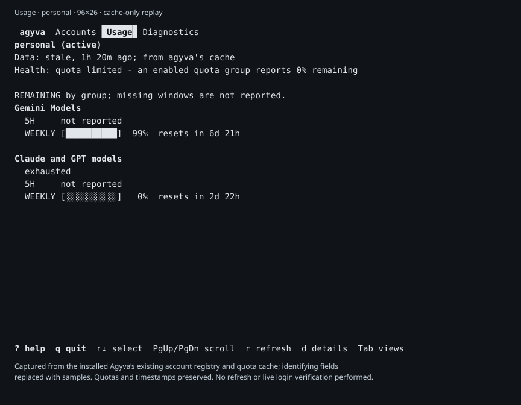

# agyva

[](https://github.com/0x1d1e/agyva/actions/workflows/ci.yml)
[](LICENSE)
[](https://github.com/0x1d1e/agyva/releases)

Manual account manager for Google's Antigravity CLI (`agy`).

Agyva saves the logins `agy` already holds, reads their cached quota, and restores the one you pick. Snapshots stay
encrypted, every switch is journaled and verified, and the same commands drive a terminal dashboard.

**Unofficial, Linux only.** Google’s [Antigravity FAQ](https://antigravity.google/docs/faq/) says third-party tools and
account rotation are not supported on consumer plans. Read the [policy and security model](docs/security.md) first;
Agyva does not bypass limits or work around suspensions.



Real cache, sample identities, quotas and timestamps preserved, no live verification. The [Accounts
overview](docs/tui.svg) shows the **minimum remaining quota across enabled groups**, not an account-wide allowance.
[All views](docs/tui-capture.txt) · [Provenance](docs/dashboard.md#capture-provenance).

## Table of Contents

- [What it does](#what-it-does) · [Requirements](#requirements) · [Install](#install) · [Quick start](#quick-start)
- [Routing](#routing) · [Common tasks](#common-tasks) · [Security and limits](#security-and-limits)
- [Documentation](#documentation) · [License](#license)

## What it does

- Saves the login `agy` already holds as an encrypted snapshot and restores it.
- Caches quota per account — five-hour and weekly windows, resets, freshness — and invents nothing.
- Drives a terminal dashboard: Accounts, Usage, Diagnostics, filtering and help.
- Journals, checkpoints and verifies every switch; `agyva recover` finishes or rolls back a broken one.
- Plans routes from `routing.toml` groups by tier, priority or least-used plan, filtered by `--for-model`.
- Opts in to auto-switch per group, doubly gated and journaled, driven only by `agyva monitor --group NAME`.
- Moves accounts between machines with passphrase-encrypted `export`/`import`.
- Updates from GitHub Releases after checksum verification, with no telemetry.

## Requirements

Linux only (x86-64 and ARM64 / aarch64 glibc); macOS and Windows are unsupported. Install `agy` 1.5.x and sign in
separately — Agyva does not sign you in. The default store needs a Secret Service provider (GNOME Keyring, KeePassXC,
KWallet’s bridge) or the passphrase vault; see [Antigravity setup](docs/antigravity.md#choose-a-credential-store).
Building needs Rust 1.88 or newer.

## Install

Install the latest release on Linux x86-64 or ARM64 (glibc) with [`install.sh`](install.sh):

```sh
curl -fsSL https://raw.githubusercontent.com/0x1d1e/agyva/main/install.sh | sh
```

The installer checks OS, architecture, and glibc, verifies the release archive against `SHA256SUMS`, and installs into
`~/.local/bin/agyva`. Pass options via `sh -s --`: `--version <vX.Y.Z>`, `--prefix <dir>`, or `--uninstall`.

Or download the release archive or standalone binary and `SHA256SUMS` from a `v*` release ([`release.yml`](.github/workflows/release.yml))
and verify manually:

```sh
sha256sum -c SHA256SUMS
tar -xzf agyva-0.1.2-x86_64-unknown-linux-gnu.tar.gz
install -Dm755 agyva-0.1.2-x86_64-unknown-linux-gnu/agyva ~/.local/bin/agyva
```

Or build this tree:

```sh
git clone https://github.com/0x1d1e/agyva.git && cd agyva
cargo install --path . --locked
```

Put the binary directory on your `PATH`; Agyva does not edit shell configuration. The published release is
[v0.1.2](https://github.com/0x1d1e/agyva/releases/tag/v0.1.2), and this tree builds the same version. The gate
accepts `agy` 1.5.x, shaped from 1.5.9 observations, but **keyring writes are unverified** — see
[compatibility](docs/compatibility.md).

## Quick start

Log in with `agy` and save that login; repeat per account:

```sh
agyva add --alias personal      # save the login agy already holds
agyva list                      # saved accounts, and which is active
agyva usage --all --no-refresh  # cached quota, without running agy
agyva use personal              # explicit manual switch
agyva usage                     # read quota for the active account
agyva                           # open the terminal dashboard
```

`add` saves the login `agy` already holds; it does not sign you in. `use` takes an alias, list number, exact email,
account id or unique prefix, and `agyva use -` returns to the previous account. **Restart `agy` after each switch**:
running sessions keep the login they started with.

## Routing

Groups in `routing.toml`, beside `config.toml`, say which accounts belong together, how they rank, and which quota group
pays for a model family.

- `route list` names each group; `route inspect|plan GROUP` rank cached evidence without running agy; `--for-model
  FAMILY` keeps accounts whose cached catalog offers that family.
- `route apply GROUP` makes exactly one journaled switch, refusing if evidence moved since planning (`--force` skips that
  drift check, never a pending recovery); `route history` lists the decisions.
- `agyva monitor [--group NAME]` re-ranks cached evidence on an interval; `agyva models --refresh` runs `agy models` once,
  for the active account.

Auto-switch is off by default and doubly gated: the group sets `auto_switch = true` **and** you run
`agyva config set auto_switch_ack true`. Only `agyva monitor --group NAME` drives it — configurable cooldown
(`auto_switch_cooldown_secs`, default 900s, fail-closed cooldown state), candidate age
(`auto_switch_candidate_max_age_secs`, default 21600s), active thresholds and hysteresis (default 10%), fresh-evidence
and session gates, every decision journaled. See [Plan a route](docs/commands.md#plan-a-route) and
[Opt-in auto-switch](docs/commands.md#opt-in-auto-switch).

## Common tasks

| Task | Command · where |
| --- | --- |
| See remaining quota | `agyva usage --all`; only the active account refreshes, others show their cache · [Quota](docs/antigravity.md#read-quota-and-health) |
| Drive the dashboard | `agyva`, then `Tab` view, `↑↓` select, `Enter` switch, `r` refresh, `d` details, `/` filter, `?` help, `q` quit · [Keys](docs/dashboard.md#keys) |
| Recover an interrupted switch | `agyva status`, `agyva doctor`; exit 3 means run `agyva recover` after resolving any unlock prompt · [Recovery](docs/commands.md#recover-an-interrupted-switch) |
| Script an inspection | `agyva list --json`, `agyva usage --all --no-refresh --json` · [JSON](docs/json.md) |
| Change settings, add completions | `agyva config show`, `agyva config set <key> <value>`, `agyva completions fish\|bash\|zsh` · [Settings](docs/commands.md#settings) |
| Rotate vault key or migrate mode | `agyva rekey [--mode keyring\|passphrase]` · [Rekey](docs/commands.md#rekey-the-vault) |
| Move accounts between machines | `agyva export FILE`, `agyva import FILE`; adds missing accounts, never alters saved ones · [Transfer](docs/commands.md#move-accounts-between-machines) |
| Update Agyva | `agyva update --check` reports; `agyva update` verifies and installs · [Update](docs/commands.md#update-agyva) |

## Security and limits

- Saved logins and checkpoints are AES-256-GCM envelopes; the vault key lives in the OS keyring or comes from a
  passphrase via Argon2id. Export archives are sealed under a separate passphrase (`AGYVA_ARCHIVE_PASSPHRASE`, minimum
  8 characters) using 64 MiB Argon2id (`import` accepts down to the 19 MiB floor); the vault key is never exported.
- Switches are journaled, read back and verified locally. Exit 3 means recovery is required: resolve any keyring unlock
  prompt, then run `agyva recover`.
- Quota comes only from `agy -p "/usage" --output-format json`; that envelope is locally observed and undocumented, so a
  changed shape reads as unavailable. Quota never switches because of an error, and suspended accounts are never retried.
- No telemetry and no other endpoints. The only other traffic is the optional self-update: one HTTPS request to this
  project’s GitHub Releases on supported Linux targets (`x86_64-unknown-linux-gnu` and `aarch64-unknown-linux-gnu`),
  cached in `<cache>/update-check.json` (24 hours on success, 1 hour on failure) and silent on failure.
  `check_updates = false` or `AGYVA_UPDATE_CHECK=0` disables the request; `--json` and `completions` skip the check,
  and in the TUI the notice appears on the dashboard instead of stderr.
- Encryption protects saved copies at rest, not an unlocked, compromised session. Details: [security
  model](docs/security.md) · [compatibility matrix](docs/compatibility.md).

## Documentation

| Document | What it answers |
| --- | --- |
| [Commands, settings and recovery](docs/commands.md) | Every command, flag, setting and recovery step |
| [Dashboard](docs/dashboard.md) | Views, keys, narrow terminals and capture provenance |
| [Antigravity setup](docs/antigravity.md) | Credential stores, quota windows, health, restarts |
| [JSON and exit codes](docs/json.md) | The scripting contract, field by field |
| [Security and policy](docs/security.md) | Threat model, encryption, switch safety, limits |
| [Compatibility](docs/compatibility.md) | Enforced, observed and unverified `agy` behavior |
| [Architecture](docs/architecture.md) | Modules, storage layout and switch internals |
| [Development](docs/development.md) | Build, tests, environment overrides and captures |
| [Contributing](CONTRIBUTING.md) · [Changelog](CHANGELOG.md) · [Security reports](SECURITY.md) | How to help, what changed, how to report a vulnerability |

## License

MIT. See [LICENSE](LICENSE).
