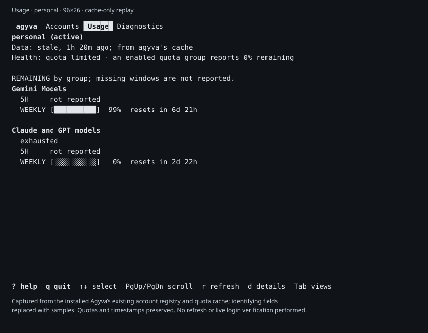

# Dashboard

[README](../README.md) · [Commands](commands.md) · [Quota and health](antigravity.md#read-quota-and-health)

Run `agyva` in an interactive terminal to open the 5-tab dashboard (`Tab` / `Shift+Tab` or `F1`-`F5`):

1. **Accounts (`F1`):** Overview table, summary strip, and sort cycling (`s`).
2. **Usage (`F2`):** Per-group quota cards, block gauges, burn rate (`%/h`), and exhaustion ETA.
3. **Endpoints (`F3`):** Custom endpoints, protocol badges, latency, model counts, and probe/fetch/activate (`t`/`f`/`Enter`).
4. **Routes (`F4`):** Active profile banner, saved local/global profiles, and `routing.toml` groups (`Enter` to apply/activate).
5. **Diagnostics (`F5`):** Environment summary and `doctor` checks.

Press `?` anywhere for the key reference.

## Overview and columns

- `●` marks the active account, endpoint, or profile; reverse video marks the selected row (including with color off).
- On terminals `>=60x12`, **Accounts** draws a Summary Metric Strip (`Active Target`, `Lowest & Burn`, plus `Endpoints` and `Next Reset` at `>=96` columns).
- **5H LEFT** and **WEEKLY LEFT** show the minimum remaining percentage across enabled groups (`—` means not reported). Excluded disabled groups do not lower the minimum; exhausted enabled groups do. Open **Usage** (`F2`) for per-group detail.
- **CACHE / AGE** shows freshness and observation age (not subscription plan).
- **BURN ETA** estimates time to exhaustion from `<cache>/quota-history.json`.
- Narrow terminals drop columns in order: `BURN ETA`, `CACHE / AGE`, `WEEKLY LEFT`, `STATUS`, `5H LEFT`.

## Endpoints and Routes tabs

- **Endpoints (`F3`):** Shows protocol badges (`[OPENAI]`, `[RESPONSES]`, `[ANTHROPIC]`, `[GEMINI]`, `[AZURE]`, `[OLLAMA]`, `[COHERE]`, `[CUSTOM]`, `[AUTO]`), latency, cached models, default model, and rate-limit/credit status. `t` tests connectivity, `f` fetches models, `d` opens details, `Enter` activates and syncs `agy`'s `settings.json`.
- **Routes (`F4`):** Lists local `.agyva.toml` and global `profiles.toml` profiles plus `routing.toml` groups with ranked accounts and exclusion reasons. `Enter` activates a profile or confirms `route apply` for a group.

## Keys

| Key | Action |
| --- | --- |
| `Tab`, `Shift+Tab`, `F1`-`F5` | Switch tab (`Accounts`, `Usage`, `Endpoints`, `Routes`, `Diagnostics`). |
| `↑`/`↓`, `j`/`k` | Move selection (scrolls Diagnostics and overlays). |
| `1`-`9` | Quick-select item by number (when total < 10 for that digit). |
| `Enter` | Open confirmation to switch account, activate endpoint, or apply route/profile (no-op in Diagnostics). |
| `y` | Confirm pending action. |
| `n`, `Esc`, `q` (in confirm) | Cancel pending action. |
| `s` | Cycle Accounts sort (`default`, `quota`, `alias`, `freshness`). |
| `t`, `f` | Test (`t`) or fetch models (`f`) for selected endpoint on Endpoints tab. |
| `r` | Queue a normal refresh for the active account. |
| `d` | Open details overlay (Accounts, Usage, Endpoints, Routes). |
| `/` | Filter items (Accounts, Usage, Endpoints, Routes). `Enter` keeps filter; `Esc` clears. |
| `?` | Toggle help overlay. |
| `PageUp`/`PageDown`, `Home`/`End` | Scroll Usage, Diagnostics, or overlays. |
| `q`, `Esc` | Quit (or close overlay / clear filter first). |
| `Ctrl+C` | Quit immediately (defers until an in-flight switch finishes). |

## Refresh and switch behavior

- Startup loads the cache first, then queues one normal refresh. Relative ages and freshness re-evaluate every 30s (`quota_fresh_secs`). No background refresh loop runs automatically.
- Switches use the same journaled path as `agyva use` (never `--force`). **Restart `agy` after switching.**
- Passphrase vaults cannot prompt inside raw-mode TUI; set `AGYVA_PASSPHRASE` or use `agyva use` in a shell.
- `color = never` or nonempty `NO_COLOR` disables ANSI colors while keeping bold/reverse selection.

## Capture provenance

`scripts/capture-tui.sh` renders [sanitized evidence](capture-data/accounts.json) into scratch directories via Ratatui's `TestBackend` (no live refresh, no credentials).

- Sample identities: `personal@example.invalid` and `work@example.invalid` (both stale, `quota_limited`, timestamps preserved from November 15, 2026).
- Gemini weekly remaining: `98.9199995994568%` (personal) and `100%` (work). Claude/GPT weekly remaining: `0%` (so [Accounts](tui.svg) shows `0%` weekly minimum). Five-hour windows and plans are unreported.
- [All rendered views](tui-capture.txt) covers Accounts, Usage, Details, Help, narrow widths, and overlays. For synthetic demo data, run `scripts/capture-tui.sh --synthetic /tmp/demo.txt`. See [development scripts](development.md#scripts).
